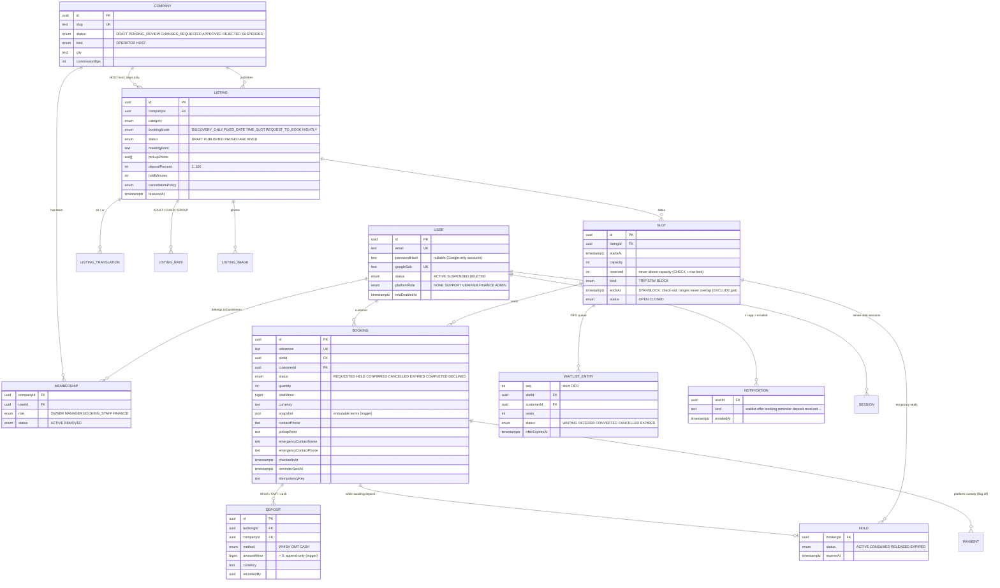

# Entity relationship diagram (core)

The full schema is `packages/database/prisma/schema.prisma` (about 45 models). This diagram shows the tables the core
flow touches: publish a trip, take bookings up to capacity, track deposits, waitlist, check-in. Billing, ledger,
promos, reviews and platform admin tables are omitted for readability.

Integrity rules enforced in the database, not only in code: `slot.reserved <= capacity`; no two live stays or blocks overlap on a property (exclusion constraint); append-only `audit_event`,
`deposit`, `ledger_*`, `plan_price`, `invoice`; immutable `booking.snapshot`; at least one active OWNER per company;
unique `(method, reference)` on platform payments; single-use tokens.
